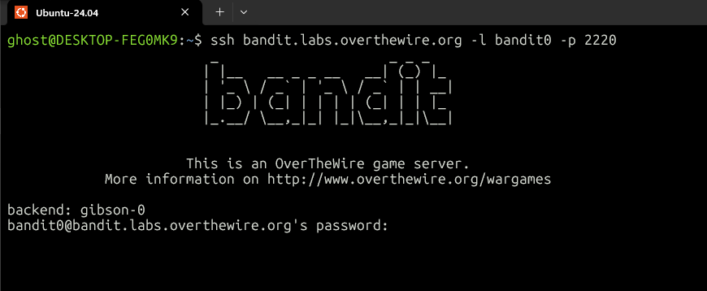
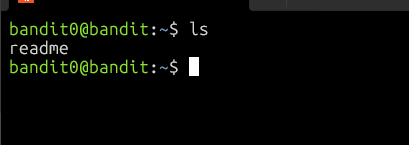
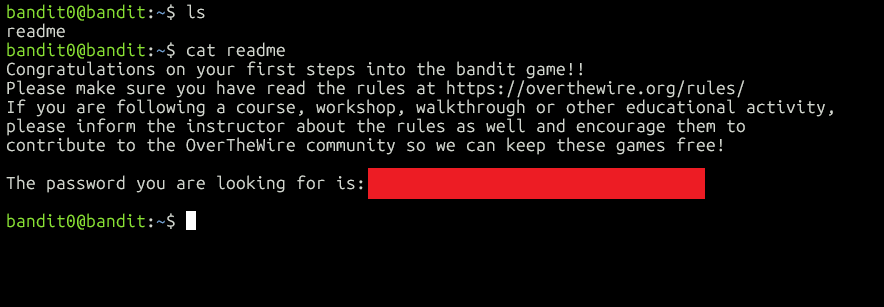

# OverTheWire Bandit level 0 Write-up
This is the first level of the Bandit series and is aimed at absolute beginners. Each level gives you what you need for the next level.

## Goal
Connect to the game server over SSH and obtain the password for Level 1.

## Step 1: Connect via SSH
We need to connect via SSH "bandit.labs.overthewire.org" on port "2220" , with user "bandit0" and the password "bandit0".
We can do this using:
```bash
ssh bandit.labs.overthewire.org -l bandit0 -p 2220
```
Then we have to enter the password which is "bandit0"


And we are in!

## Step 2: List the files
Now we use "ls" to list the files in the directory.
```bash
ls
```


## Step 3: Read the file
Finally we can view the contents of the readme file using:
```bash
cat readme
```


## What I learned
- `-l` sets the username and `-p` sets the port in `ssh`.
- `ls` lists the contents of a directory
- `cat` prints the contents of a file
- Passwords stored in plain text files are a common weakness in the real world.

## Password for Level 1
`[redacted]`