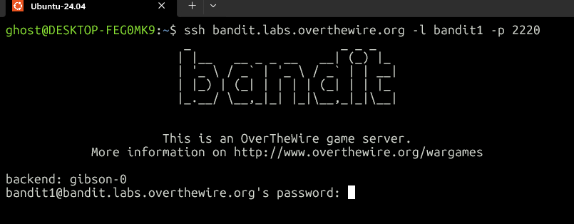
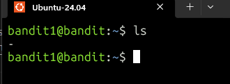
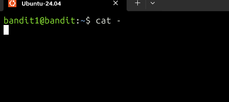
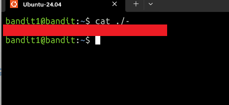

# OverTheWire Bandit level 1 Write-up
This is the second level of the Bandit Series from OverTheWire.

## Goal
Connect to the game server via SSH and obtain the password for Level 2.

## Step 1: Connect via SSH
We need to connect via SSH `bandit.labs.overthewire.org` on port `2220`, with user `bandit1` and the password we found in Level 0.
We can do this using:
```bash
ssh bandit.labs.overthewire.org -l bandit1 -p 2220
```



## Step 2: List the files
Use `ls` to list the files in the directory.
```bash
ls
```


## Step 3: Read the file
If we want to read the contents of the file using `cat -` we see nothing. The reason for this is that for cat, a lone `-` means “read what I type on the keyboard”, not “open a file named `-`”. So `cat -` doesn't open the file. It waits for your input.


So if we want to tell Linux that `-` is a file we should use `./-`. Using:
```bash
cat ./-
```


## Alternative
We can use:
```bash
more -
```
But the first method is more reliable.

## What I learned
- A lone `-` often means standard input in Unix tools, so `cat -` waits for input instead of opening a file.
- `./` makes the path explicit, so a file named `-` is treated as a file.
- `more -` also worked because `more` handles `-` differently. Different commands treat `-` differently, so it's worth testing rather than assuming.

## Password for Level 2
`[redacted]`