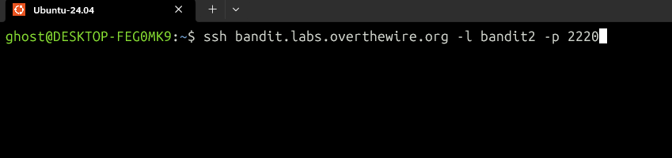
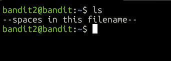
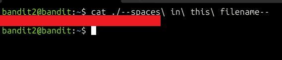

# OverTheWire Bandit Level 2 Write-up
This is the third level of the Bandit series from OverTheWire.

## Goal
Connect to the game server via SSH and obtain the password for Level 3.

## Step 1: Connect via SSH
Log in as `bandit2` with the password we found in Level 1:

```bash
ssh bandit.labs.overthewire.org -l bandit2 -p 2220
```



## Step 2: List the files
We use `ls` to list the files in the directory:

```bash
ls
```



The file is named `--spaces in this filename--`.

## Step 3: Read the file
This file name causes two problems:

1. It starts with `--`, so `cat` would treat it as an option, not a file. Adding `./` in front turns it into a path, which fixes this.
2. It contains spaces. The shell splits a command at each space, so `cat` would receive four separate arguments instead of one file name. Putting a `\` before each space tells the shell the space is part of the name.

The final command is:

```bash
cat ./--spaces\ in\ this\ filename--
```



## Alternative
Wrapping the whole path in quotes also keeps it as a single argument:

```bash
cat "./--spaces in this filename--"
```

## What I learned
- A file name starting with `-` or `--` can be mistaken for an option, so use `./` to make it a path.
- The shell splits arguments at spaces. A `\` before a space (called escaping) or quotes around the name keeps it as one argument.
- Pressing Tab while typing a file name auto-completes it and adds the needed escapes for you.

## Password for Level 3
`[redacted]`