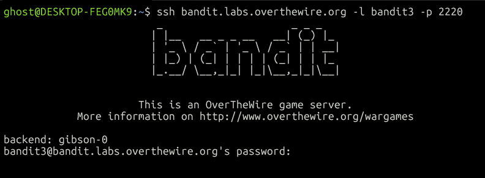
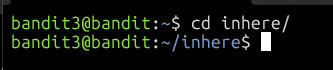
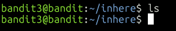
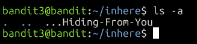
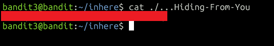

# OverTheWire Bandit Level 3 Write-up
This is the fourth level of the Bandit series from OverTheWire.

## Goal
Connect to the game server via SSH and obtain the password for Level 4.

## Step 1: Connect via SSH
Log in as `bandit3` with the password we found in Level 2:

```bash
ssh bandit.labs.overthewire.org -l bandit3 -p 2220
```



## Step 2: List the files
We use `ls` to list the files in the directory:

```bash
ls
```


There is a directory named `inhere`, so we need to move into it.

## Step 3: Change directory
We change directory using `cd` followed by the directory name:

```bash
cd inhere
```



## Step 4: List the files in the new directory
If we run `ls` here, the directory looks empty:



In Linux, files whose names start with a dot (`.`) are hidden from a plain `ls`. We can use the `-a` option to list all files, including hidden ones:

```bash
ls -a
```



Besides the file `...Hiding-From-You`, we also see `.` (the current directory) and `..` (the parent directory), which are always present.

## Step 5: Read the file
We read the file with `cat`:

```bash
cat ./...Hiding-From-You
```



The `./` isn't strictly needed here, because the name doesn't start with `-`, but it's harmless.

## What I learned
- Files and directories whose names start with `.` are hidden by default.
- `ls -a` lists all files, including hidden ones, plus `.` and `..`.
- `cd <directory>` changes the working directory.

## Password for Level 4
`[redacted]`